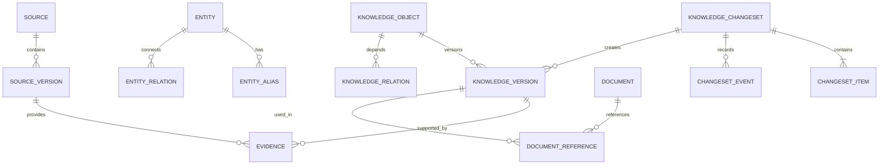

# Knowledge Engine
### AI-Native Knowledge Management System

**문서 버전:** v0.2.0\
**작성일:** 2026.11.26  
**개정일:** 2026.11.27\
**문서 상태:** 초기 개발 기획 및 기술 설계  
**프로젝트 유형:** AI 기반 개인 지식 관리 플랫폼

---

# 1. 프로젝트 개요

## 1.1 배경

기존 개인 지식 관리 시스템(PKM)은 인간이 직접 문서를 작성하고 분류하며 연결하는 방식을 기반으로 발전해 왔다.

LLM의 등장으로 RAG 및 LLM Wiki와 같이 AI를 활용한 지식 관리 방식이 등장했으나, 여전히 대부분의 시스템은 자연어 문서를 지식의 기본 저장 단위로 사용한다.

문서 중심의 지식 관리 방식은 다음과 같은 한계를 가진다.

- 동일한 지식이 여러 문서에 중복되어 존재한다.
- 개별 지식의 출처와 유효성을 관리하기 어렵다.
- 특정 지식의 변경이 다른 문서에 미치는 영향을 정확하게 파악하기 어렵다.
- 문서 간 링크만으로는 지식 간 관계의 의미를 파악하기 어렵다.
- 지식의 규모가 증가할수록 일관성 유지에 필요한 비용이 증가한다.
- AI가 문서를 수정할 때 기존 문맥이나 검증된 지식을 훼손할 가능성이 있다.

본 프로젝트는 이러한 문제를 해결하기 위해 인간이 지식을 읽는 방식과 시스템이 지식을 관리하는 방식을 분리한다.

## 1.2 제품 정의

Knowledge Engine은 원본 자료로부터 지식을 추출하고, 이를 독립적인 객체와 의미적 관계로 구조화하여 저장하며, 인간이 읽기 좋은 위키 문서로 제공하는 AI 기반 지식 관리 시스템이다.

단순히 정보를 저장하고 검색하는 것이 아니라 지식의 생성, 연결, 검증, 변경, 폐기까지 전체 생애주기를 관리하는 것을 목표로 한다.

## 1.3 제품 비전

**Machine-managed, Human-consumed, Human-governed.**

시스템이 지식과 관계를 관리하고, 사용자는 위키와 질의응답에서 결과와 원본을 함께 확인한다. 어떤 출처를 우선할지, 자신의 의견이나 프로젝트 결정을 어떻게 기록할지는 사용자가 정한다.

## 1.4 핵심 가치

- **Accumulation:** 새로운 지식을 기존 지식에 지속적으로 누적한다.
- **Traceability:** 모든 핵심 지식의 근거를 추적할 수 있도록 한다.
- **Consistency:** 지식 간 중복과 모순을 관리한다.
- **Maintainability:** 지식이 변경될 때 관련 지식의 영향 범위를 분석한다.
- **Readability:** 구조화된 지식을 인간이 이해하기 좋은 형태로 제공한다.
- **Portability:** 특정 AI 모델이나 서비스에 종속되지 않는다.

---

# 2. 시장 및 제품 포지셔닝

## 2.1 기존 제품과의 개념적 비교

| 구분 | Obsidian | RAG | LLM Wiki | Knowledge Engine |
|---|---|---|---|---|
| 기본 관리 단위 | 문서 | 텍스트 청크 | 문서 | 지식 객체 및 문서 |
| 지식 구조화 | 사용자 | 제한적 | AI | AI 및 시스템 |
| 관계 관리 | 문서 링크 | 유사도 | 문서 링크 중심 | 의미적 관계 |
| 지식 축적 | 수동 중심 | 자료 추가 | 문서 갱신 | 객체 및 관계 갱신 |
| 지식 검증 | 사용자 중심 | 답변 시 근거 확인 | AI 검수 | 자동 검증 및 근거 상태 관리 |
| 변경 영향도 | 별도 관리 | 제한적 | AI 탐색 | 의존성 기반 분석 |
| 버전 관리 | 파일 중심 | 자료 중심 | 문서 중심 | 지식 중심 |

위 비교는 각 제품군의 일반적인 아키텍처를 기준으로 한다. 개별 제품 및 플러그인은 확장 기능을 통해 유사한 기능을 제공할 수 있다.

## 2.2 차별화 전략

본 프로젝트는 단순한 노트 편집기나 AI 채팅 인터페이스를 경쟁력으로 삼지 않는다.

다음 세 가지 기능의 결합을 핵심 차별화 요소로 설정한다.

1. **Knowledge Object**로 개별 주장을 식별하고 원본 근거를 연결한다.
2. **Knowledge Dependency**로 지식 사이의 관계를 표현하고 변경 영향을 분석한다.
3. **Knowledge Changeset(지식 변경 집합)**으로 변경을 묶어 자동 검증하고, 적용 이력을 따라 이전 상태를 복구한다.

핵심 경쟁력은 개별 기능의 존재 여부보다는 이러한 기능을 하나의 일관된 데이터 모델과 관리 워크플로로 제공하는 데 있다.

---

# 3. 목표 사용자

## 3.1 초기 타깃

개인 지식 베이스를 지속적으로 구축하는 개발자 및 기술 학습자.

### 주요 특성

- 기술 문서, 블로그, PDF, AI 대화를 자주 참고한다.
- 학습 내용을 TIL, Markdown, 위키 형태로 정리한다.
- 동일한 개념을 여러 프로젝트에서 반복적으로 활용한다.
- 기술 버전 변화로 기존 지식이 오래되는 문제를 경험한다.
- AI 에이전트 및 개발 도구 사용에 익숙하다.

## 3.2 확장 가능한 사용자

- 대학생 및 대학원생
- 연구자
- 기술 문서 작성자
- 기업 내부 지식 관리 담당자
- 전문 분야의 지속적인 학습이 필요한 실무자

초기 MVP에서는 개인 사용자와 개발 지식 관리에 집중한다. 기업용 권한 관리 및 협업 기능은 후속 범위로 설정한다.

---

# 4. 핵심 설계 철학

## 4.1 Document-centric에서 Knowledge-centric로

기존 위키에서는 문서가 지식을 직접 소유한다.

Knowledge Engine에서는 개별 지식이 독립적으로 존재하며, 문서는 하나 이상의 지식 객체를 참조하여 구성된다.

이는 관계형 데이터베이스의 정규화된 데이터와 View의 관계에 비유할 수 있다.

## 4.2 지식 저장과 표현의 분리

시스템은 다음 세 계층으로 구성한다.

### Source Layer

지식의 근거가 되는 원본 자료를 보관한다.

- 웹페이지
- PDF
- Markdown
- AI 대화
- 사용자 메모
- 기술 명세
- 코드 및 프로젝트 문서

### Semantic Layer

Knowledge DB는 에이전트가 지식을 찾고, 관계를 따라가며, 원본과 대조할 수 있도록 중간 표현을 저장한다.

- 개념
- 사실 및 주장
- 지식 간 관계
- 출처
- 근거 상태
- 변경 이력
- 적용 조건

### Presentation Layer

인간이 지식을 이해하고 활용할 수 있는 인터페이스를 제공한다.

- 위키 문서
- 자연어 설명
- 비교 문서
- 학습 가이드
- 지식 그래프
- 변경 이력
- 원본 근거 확인 및 오류 신고

## 4.3 Knowledge Compilation

본 시스템의 지식 처리 과정을 컴파일러 구조에 비유한다.

```text
Raw Sources
     |
     v
Knowledge Extraction
     |
     v
Semantic IR
     |
     v
Automated Validation
     |
     v
Changeset Application → Knowledge Store
     |
     v
Document Generation
     |
     v
Human-readable Wiki
```

Semantic IR(Intermediate Representation)은 원본 자료와 최종 위키 문서 사이에서 지식을 구조적으로 표현하는 중간 계층이다.

이 계층을 통해 원본 자료를 반복적으로 분석하지 않고도 지식 검색, 관계 탐색, 검증, 문서 재구성이 가능하도록 한다.

## 4.4 Hybrid Architecture

모든 자연어 문장을 지식 객체로 변환하지 않는다.

설명, 비유, 사례, 서술 흐름은 자연어 문서에 유지할 수 있도록 하며, 출처 추적이나 일관성 관리의 가치가 높은 핵심 지식만 구조화한다.

자연어 문서의 표현력과 지식 그래프의 구조적 관리 능력을 동시에 확보하는 것을 목표로 한다.

---

# 5. 도메인 모델

## 5.1 Source

지식의 근거가 되는 원본 자료.

주요 속성:

- Source ID
- 자료 유형
- 제목
- 원본 URL 또는 파일 경로
- 수집 시각
- 원본 콘텐츠 해시
- 자료 버전
- 작성자
- 원문 내용

원본 자료의 수정 및 삭제가 기존 지식의 근거를 훼손하지 않도록 가능한 범위에서 버전별 스냅샷을 보관한다.

## 5.2 Entity

지식이 설명하는 대상 또는 개념.

예시:

- Redis
- TTL
- Spring Boot
- Transactional Outbox
- 데이터베이스 트랜잭션

주요 속성:

- Entity ID
- 대표 명칭
- 별칭
- 설명
- 유형
- 관련 도메인

동일한 개념이 여러 이름으로 존재하는 경우 Entity Resolution을 통해 통합한다.

## 5.3 Knowledge Object

독립적으로 식별, 검증, 갱신할 수 있는 지식의 논리적 단위.

지식 객체는 개념 자체와 구분한다. Redis는 Entity이며, Redis가 TTL을 지원한다는 진술은 Knowledge Object이다.

### 예시

```json
{
  "id": "K-001",
  "subjectId": "E-REDIS",
  "predicate": "supports",
  "objectId": "E-TTL",
  "statement": "Redis는 키의 만료 시간을 설정할 수 있다.",
  "type": "fact",
  "qualifiers": {
    "product": "Redis"
  },
  "evidenceStatus": "SUPPORTED",
  "lifecycleStatus": "ACTIVE",
  "version": 1
}
```

### 지식 유형

| 유형 | 설명 |
|---|---|
| FACT | 검증 가능한 사실 |
| DEFINITION | 개념의 정의 |
| CLAIM | 출처가 주장하는 내용 |
| INFERENCE | 다른 지식으로부터 도출한 추론 |
| PROCEDURE | 작업 수행 방법 |
| OPINION | 개인 또는 출처의 의견 |
| OBSERVATION | 경험 및 관찰 결과 |
| DECISION | 특정 조건에서 내린 의사결정 |

사실과 의견, 일반적인 지식과 개인적인 판단을 구분하여 관리한다.

## 5.4 Evidence

특정 지식 버전의 주장을 뒷받침하거나 반박하는 근거.

하나의 지식은 복수의 Evidence를 가질 수 있다.

주요 속성:

- Evidence ID
- Knowledge Version ID
- Source Version ID
- 원문 발췌
- 페이지 또는 문단 위치
- 근거 유형: supports, contradicts
- 검토 결과
- 수집 시각

출처가 존재한다는 사실만으로 해당 지식이 검증되었다고 간주하지 않는다.

## 5.5 Knowledge Relation

개념 및 지식 객체 사이의 의미적 관계.

### 개념 수준 관계

| 관계 | 의미 |
|---|---|
| is_a | 상위 개념에 속함 |
| part_of | 구성 요소임 |
| supports | 특정 기능을 지원함 |
| used_for | 특정 목적에 활용됨 |
| alternative_to | 대안 관계 |
| related_to | 일반적인 연관 관계 |

### 지식 수준 관계

| 관계 | 의미 |
|---|---|
| depends_on | 다른 지식에 의존함 |
| derived_from | 다른 지식에서 도출됨 |
| contradicts | 다른 지식과 모순됨 |
| supersedes | 기존 지식을 대체함 |
| qualifies | 다른 지식의 적용 조건을 제한함 |

개념 간 연관성과 지식 간 논리적 의존성을 구분한다.

모든 관계를 변경 전파 대상으로 처리하지 않는다. 관계 유형에 따라 영향도 분석 정책을 별도로 정의한다.

## 5.6 Knowledge Version

특정 시점의 지식 객체 상태.

주요 속성:

- Version ID
- Knowledge Object ID
- 버전 번호
- 지식 내용
- 근거 상태 및 생애주기 상태
- 적용 시작 시점
- 적용 종료 시점
- 시스템 기록 시점
- 변경 사유
- 변경 주체
- Knowledge Changeset ID

지식이 현실에서 유효했던 시간과 시스템이 해당 사실을 기록한 시간을 구분할 수 있도록 설계한다.

## 5.7 Wiki Document

인간에게 제공되는 지식의 표현물.

문서는 자연어 설명과 지식 객체 참조를 함께 포함한다.

주요 속성:

- Document ID
- 제목
- 문서 본문
- 참조 지식 객체 목록
- 생성 방식
- 생성 시각
- 사용자 편집 여부
- 갱신 상태

## 5.8 Knowledge Changeset

하나의 자료나 정정에서 함께 발생한 지식 변경을 검증·적용·복구하는 단위다. 각 항목에 대상과 기준 버전, 변경 전후 내용, 사유, 원본 근거를 기록한다. 집합에는 검증 결과, 영향받는 지식·문서, 적용 결과를 남긴다.

다음 변경을 하나의 단위로 관리한다.

- 지식 생성
- 지식 수정
- 지식 대체 및 비활성화
- 관계 추가 및 삭제
- 출처 추가
- 근거 상태 변경

복구할 때는 원래 Changeset을 가리키는 새 Changeset을 적용한다. 어떤 변경을 왜 되돌렸는지도 이력에서 확인할 수 있다.

---

# 6. 주요 기능 요구사항

## FR-01. 자료 수집

사용자는 파일, URL, 텍스트 등의 형태로 원본 자료를 등록할 수 있어야 한다.

시스템은 콘텐츠 해시를 활용하여 동일한 자료의 중복 등록을 탐지한다.

기존 자료가 변경된 경우 새로운 Source Version을 생성한다.

## FR-02. 지식 추출

AI는 원본 자료에서 관리 가치가 있는 핵심 지식을 추출한다.

추출 결과는 사전에 정의된 데이터 스키마를 준수해야 한다.

각 지식에는 가능한 범위에서 원문의 근거 위치와 적용 조건을 포함한다.

출처에서 확인할 수 없는 내용을 사실로 등록하지 않는다.

## FR-03. 지식 통합

새롭게 추출된 지식을 기존 지식 베이스와 비교한다.

시스템은 다음 중 하나의 처리 방식을 제안한다.

| 처리 유형 | 설명 |
|---|---|
| CREATE | 새로운 지식 생성 |
| MERGE | 기존 지식에 근거 추가 |
| UPDATE | 기존 지식 수정 |
| CONTRADICT | 기존 지식과의 충돌 등록 |
| SUPERSEDE | 기존 지식을 새로운 지식으로 대체 |
| IGNORE | 중복 또는 관리 가치가 낮은 내용 제외 |

자동 유사도 검색은 비교 후보를 찾는 데 사용한다. 의미적 동일성 및 모순 여부는 별도의 판단 과정을 거친다.

## FR-04. 의미적 관계 구축

지식 객체와 개념 사이의 관계를 생성한다.

의존 관계, 대안 관계, 상위 개념 관계 등을 명시적으로 저장한다.

추출한 관계는 Changeset에 포함한다. 엔진은 연결 대상이 존재하는지, 관계 유형과 방향이 원문의 의미에 맞는지 확인한다.

## FR-05. 지식 변경의 자동 검증과 적용

자료 등록 시 엔진은 추출·통합 결과를 Changeset으로 묶고 적용 전에 다음 검사를 수행한다.

| 검사 | 수행 주체와 판단 기준 |
|---|---|
| 구조 검증 | 프로그램이 스키마, 참조 무결성, 관계 유형별 순환 정책, 기준 버전을 검사한다. 인용 위치와 발췌문이 보존된 원본 버전에서 확인되는지도 대조한다. |
| 의미 검증 | LLM과 검증 도구가 원문이 주장을 뒷받침하는지, 기존 지식과 중복되거나 상충하는지, 적용 버전·환경이 같은지 판단한다. 근거와 판단 이유를 함께 남긴다. |
| 영향도 분석 | 엔진이 바뀌는 지식에 의존하는 지식과 해당 버전을 인용한 문서를 찾아 재검증·갱신 대상을 기록한다. |

구조가 유효하고 원본을 추적할 수 있는 일반 지식은 근거 상태와 함께 자동 반영한다. 해석이 불분명하면 원문을 재분석하고, 여전히 근거가 약하거나 상충하면 그 상태와 출처를 보존한다. 스키마 위반, 깨진 참조, 원본에 없는 인용은 재분석한다. 오류가 남으면 해당 후보를 격리하고 위키와 답변의 근거에서 제외한다.

사용자는 출처 우선순위와 확인이 필요한 변경 유형을 정하고 오류를 신고할 수 있다. 외부 자료가 사용자의 의견이나 기존 프로젝트 결정과 충돌하면 외부 주장은 별도로 기록한다. 개인 기록의 수정은 사용자가 직접 요청하거나 제안을 확인한 뒤에만 적용한다.

하나의 Changeset은 한 트랜잭션으로 적용한다. 격리 대상이나 사용자 확인이 필요한 항목이 있으면 독립적으로 적용할 수 있는 변경만 별도 집합으로 묶어 검증한다. 적용 시점에 기준 버전이 바뀌었으면 최신 버전을 기준으로 다시 검증한다.

## FR-06. 위키 문서 생성

사용자는 특정 개념 또는 주제에 대한 위키 문서를 생성할 수 있어야 한다.

시스템은 관련 지식 객체와 원본 자료를 활용하여 자연스러운 설명을 생성한다.

생성된 문서는 사용한 지식 객체의 ID와 버전을 기록한다.

핵심 사실에서 인용한 원문 위치를 열 수 있어야 한다. 근거가 부족하거나 상충하는 주장을 포함할 때는 적용 조건과 근거 상태를 본문에 표시한다.

## FR-07. 지식 변경 영향도 분석

특정 지식이 변경되었을 때 관련 지식 및 문서에 미치는 영향을 분석한다.

영향받는 대상을 다음과 같이 분류한다.

- 직접 영향을 받는 지식
- 간접 영향을 받을 가능성이 있는 지식
- 갱신이 필요한 문서
- 검토가 필요한 관계

영향이 감지되었다는 이유만으로 관련 지식을 자동 수정하지 않는다.

재검증 대상을 원본과 다시 대조하고, 수정이 필요한 항목은 새 Changeset으로 처리한다.

## FR-08. 지식 버전 관리

개별 지식의 변경 이력을 조회할 수 있어야 한다.

사용자는 과거 버전의 내용과 근거를 확인하고 Changeset 단위로 복구할 수 있다. 이후 변경이 같은 항목을 수정했다면 충돌을 표시하고 현재 버전을 기준으로 복구 범위를 다시 검증한다.

## FR-09. 지식 검색 및 질의응답

사용자는 자연어 질의를 통해 지식 베이스를 탐색할 수 있어야 한다.

검색에는 다음 방식을 조합한다.

- 키워드 검색
- 벡터 유사도 검색
- 메타데이터 필터링
- 개념 및 관계 탐색

AI 답변은 사용한 지식과 출처를 표시한다.

기술 명세를 묻는 질문에는 원문 근거가 확인된 지식을 우선한다. 아이디어를 탐색하는 질문에는 근거가 제한적인 주장도 그 한계와 함께 제시할 수 있다. 결론이 엇갈리면 적용 조건과 양쪽 출처를 함께 보여준다.

## FR-10. 지식 유지보수

자료를 등록하거나 지식이 바뀔 때 수행하는 검증은 MVP에 포함한다. 후속 단계에서는 새 자료 등록 없이도 다음 작업을 주기적으로 수행한다.

- 외부 자료 변경 감지
- 오래된 지식 재검증
- 중복 지식 탐지
- 잠재적 모순 탐지
- 지식 관계의 정합성 검사
- 근거가 부족한 지식 식별

## FR-11. 데이터 내보내기

사용자는 위키 문서를 Markdown으로 내보낼 수 있어야 한다.

지식 객체, 관계, 출처 및 버전 이력은 JSON 등 구조화된 형식으로 내보낼 수 있어야 한다.

기존 Obsidian Vault에서 데이터를 가져오거나 내보낼 수 있는 기능을 고려한다.

---

# 7. 지식 처리 워크플로

## 7.1 자료 등록 및 지식 반영

```text
자료 등록 → 원본 버전 보존 → 지식·근거 추출 → 기존 지식·관계와 통합 후보 구성
  → Changeset 생성 → 구조 검증
    ├─ 구조 오류·잘못된 인용 → 재분석 후 다시 검증 → 오류가 지속되면 격리
    └─ 구조 유효 → 의미 검증 및 영향도 분석
        ├─ 일반 지식 → 근거 상태와 함께 자동 적용 → 관련 문서 갱신
        └─ 정책상 확인 대상 → 사용자가 변경을 선택하면 적용
```

## 7.2 지식 변경 및 영향도 분석

```text
Changeset 적용 → 새 지식 버전과 변경 근거 기록
  → 의존 지식과 인용 문서 식별 → 해당 지식의 원본 근거 재검증
  → 수정이 필요한 경우 후속 Changeset 검증·적용 → 영향받은 문서 갱신
```

예를 들어 Redis 관련 주장의 적용 버전이 바뀌면, 엔진은 그 주장을 인용한 문단을 찾아 갱신한다. 사용자가 직접 작성한 문단은 보존하고 수정안을 제시한다. Changeset을 복구할 때도 같은 경로로 관련 지식과 문서를 재검증한다.

## 7.3 지식 상태 관리

지식 버전마다 원본이 주장을 얼마나 뒷받침하는지 기록한다. 근거 상태는 해당 버전을 현재 사용하는지를 나타내는 생애주기 상태와 독립적이다.

### 근거 상태

| 상태 | 기록 기준 | Redis 자료의 예 |
|---|---|---|
| SUPPORTED (근거 확인) | 명시된 조건에서 원문이 주장을 직접 뒷받침한다. | 공식 문서에서 키에 만료 시간을 설정하는 기능을 확인했다. |
| INSUFFICIENT (추가 근거 필요) | 출처는 추적되지만 결론을 뒷받침하는 범위가 제한적이다. | 한 서비스의 세션 저장소 벤치마크만으로 다른 환경에서의 성능을 예측한다. |
| DISPUTED (상충하는 근거) | 적용 조건을 대조한 뒤에도 양립하기 어려운 결과가 남는다. | 같은 조건에서 세션 저장 비용에 대해 상반된 결과를 보고한 자료가 있다. |

### 생애주기 상태

- ACTIVE: 현재 사용되는 지식
- SUPERSEDED: 새로운 지식으로 대체됨
- ARCHIVED: 보관된 지식

근거 확인은 기록된 원본과 조건 안에서의 판단이다. 새 근거가 들어오면 재검증 작업을 등록하고 그 결과로 근거 상태를 갱신한다. 구조 오류로 격리한 후보는 Changeset 이력에서 조회할 수 있다.

---

# 8. 시스템 아키텍처

## 8.1 전체 구조

```text
Presentation Layer
  - Wiki Editor
  - Knowledge Graph
  - Change History
  - AI Chat
         |
Application API
         |
Knowledge Management Engine
  - Source Management
  - Entity Resolution
  - Knowledge Integration
  - Dependency Analysis
  - Version Management
  - Automated Validation
  - Changeset Management & Rollback
  - Document Generation
         |
AI Agent Runtime
  - Extraction Agent
  - Integration Agent
  - Validation Agent
  - Generation Agent
         |
AI Provider / Agent Adapter
  - OpenAI
  - Anthropic
  - Local LLM
  - CLI Agent (optional)

Persistence Layer
  - PostgreSQL
  - Vector Index
  - Source Storage
  - Changeset History
  - Job Queue
```

## 8.2 Knowledge Management Engine

시스템의 핵심 비즈니스 로직을 담당한다.

AI 모델이 데이터베이스를 직접 조작하거나 검증된 지식을 임의로 덮어쓰지 않도록 한다.

모든 지식 변경은 도메인 서비스의 자동 검증과 사용자 정책을 거친다. 구조 검사는 프로그램이 수행하고 의미 검증에는 원본과 적용 조건을 함께 전달한다.

AI는 변경을 제안하며, 시스템은 변경의 유효성을 판단하고 적용한다.

## 8.3 AI Agent Runtime

AI 작업을 수행하는 실행 계층.

### 논리적 역할

| 역할 | 주요 책임 |
|---|---|
| Extractor | 원본 자료에서 지식 추출 |
| Curator | 기존 지식과 비교 및 통합 제안 |
| Validator | 근거 및 모순 검토 |
| Maintainer | 변경 영향도 분석 결과 재검토 |
| Writer | 인간이 읽기 좋은 문서 생성 |
| Researcher | 부족한 지식 및 추가 자료 제안 |

초기 MVP에서는 각 역할을 독립적인 자율 에이전트로 구현하지 않는다.

단일 LLM 실행 환경에서 역할별 프롬프트, 구조화된 출력 및 순차적 워크플로를 적용한다.

필요성이 검증된 이후 멀티 에이전트 구조로 확장한다.

## 8.4 AI Adapter

LLM 제공자와 애플리케이션의 결합도를 낮추기 위한 추상화 계층.

지원 후보:

- OpenAI API
- Anthropic API
- OpenAI 호환 로컬 API
- Ollama
- CLI 기반 코딩 에이전트

CLI 에이전트 연동은 해당 서비스의 이용 정책, 인증 방식, 자동화 지원 범위를 확인한 뒤 제공한다.

모든 Adapter가 동일한 구조화 출력이나 도구 호출 기능을 제공한다고 가정하지 않는다.

## 8.5 비동기 작업 처리

자료 분석 및 위키 생성은 실행 시간이 길어질 수 있으므로 API 요청과 분리하여 작업 단위로 처리한다.

작업은 다음 상태를 가진다.

- PENDING
- RUNNING
- SUCCEEDED
- FAILED
- CANCELLED

작업을 재시도해도 동일한 지식 버전이나 Changeset이 중복 적용되지 않도록 한다.

---

# 9. 데이터베이스 설계

## 9.1 주요 테이블

| 테이블 | 역할 |
|---|---|
| sources | 원본 자료 메타데이터 |
| source_versions | 원본 자료 버전 |
| entities | 개념 및 지식 대상 |
| entity_aliases | 개념의 별칭 |
| knowledge_objects | 지식의 논리적 식별자 |
| knowledge_versions | 버전별 지식 내용, 근거 상태, 생애주기 상태, 적용한 Changeset |
| knowledge_evidence | 지식과 근거의 연결 |
| entity_relations | 개념 간 의미적 관계 |
| knowledge_relations | 지식 간 의존 및 논리 관계 |
| documents | 위키 문서 |
| document_references | 문서가 참조하는 지식 버전 |
| knowledge_changesets | 변경 사유, 적용 결과, 복구 시 원래 Changeset 참조 |
| changeset_items | 대상별 기준 버전, 변경 전후 값, 원본 근거, 영향 범위 |
| changeset_events | 자동 검증 결과, 재분석·격리 사유, 정책상 필요한 사용자 결정 이력 |
| jobs | 비동기 AI 작업 |

## 9.2 논리적 ERD



실제 구현 단계에서는 관계의 시작점과 종료점에 각각 외래 키를 정의하며, 관계의 적용 버전 및 유효성도 관리해야 한다.

## 9.3 저장소 선정

초기에는 PostgreSQL을 기본 저장소로 사용한다.

- 관계형 데이터 관리
- 트랜잭션 및 정합성 확보
- JSONB 기반 가변 메타데이터 저장
- pgvector 기반 의미 검색
- Recursive CTE 기반 관계 탐색
- 전문 검색 기능 활용

별도의 그래프 데이터베이스는 실제 관계 탐색의 복잡도와 성능 문제가 확인된 이후 도입 여부를 결정한다.

---

# 10. API 설계 초안

| Method | Endpoint | 기능 |
|---|---|---|
| POST | /api/sources | 자료 등록 |
| GET | /api/sources/{id} | 원본 자료 조회 |
| POST | /api/sources/{id}/ingest | 지식 추출 작업 실행 |
| GET | /api/jobs/{id} | 비동기 작업 상태 조회 |
| GET | /api/entities/{id} | 개념 조회 |
| GET | /api/knowledge | 지식 검색 |
| GET | /api/knowledge/{id} | 지식 상세 조회 |
| GET | /api/knowledge/{id}/versions | 지식 변경 이력 |
| GET | /api/knowledge/{id}/relations | 관련 지식 조회 |
| GET | /api/knowledge/{id}/impact | 변경 영향 범위 조회 |
| GET | /api/changesets | 변경 이력 조회 |
| GET | /api/changesets/{id} | 변경 전후, 근거, 검증 결과, 영향 범위 조회 |
| POST | /api/changesets/{id}/rollback | 현재 버전을 기준으로 복구 Changeset 생성 및 검증 |
| POST | /api/changesets/{id}/decision | 정책상 확인이 필요한 변경에 대한 사용자 결정 기록 |
| POST | /api/knowledge/{id}/feedback | 사용자가 발견한 오류와 정정 근거를 받아 재검증 |
| POST | /api/documents/generate | 위키 문서 생성 |
| GET | /api/documents/{id} | 위키 문서 조회 |
| PATCH | /api/documents/{id} | 위키 문서 수정 |
| POST | /api/query | 자연어 질의응답 |

---

# 11. 사용자 인터페이스

## 11.1 Wiki Workspace

일반적인 위키 및 노트 애플리케이션과 유사한 작업 화면.

```text
+-------------+----------------------+----------------+
| 문서 탐색기  | 위키 문서 본문       | AI Assistant   |
|             |                      |                |
| Sources     | Redis                | 관련 지식      |
| Wiki        |                      | 출처           |
| Entities    | 정의 및 주요 특징    | 근거 상태      |
| History     | 활용 방법            | 질의응답       |
|             | 관련 개념            |                |
+-------------+----------------------+----------------+
```

사용자는 내부 지식 구조를 이해하지 않아도 일반적인 위키처럼 사용할 수 있어야 한다.

설정에서 우선할 출처와 확인이 필요한 변경 유형을 선택할 수 있다. 위키와 답변에서는 문제가 있는 주장과 인용을 지정해 오류를 신고할 수 있다.

## 11.2 Knowledge Inspector

개별 지식 객체의 상세 정보를 제공한다.

- 지식 내용
- 적용 조건
- 원본 근거
- 근거 상태와 판단 이유
- 버전
- 관련 개념
- 의존하는 지식
- 해당 지식을 사용하는 문서

## 11.3 Semantic Graph

의미적 관계를 탐색하는 그래프 인터페이스.

관계 유형별 필터링 및 특정 개념을 중심으로 한 부분 그래프 탐색을 제공한다.

전체 그래프를 무조건 표시하는 방식보다 현재 사용자의 관심사에 맞는 부분 그래프를 제공하는 데 집중한다.

## 11.4 변경 이력과 사용자 확인

변경 이력에서 변경 전후 내용, 원본 인용, 검증 결과와 영향을 받은 문서를 확인하고 특정 Changeset을 되돌릴 수 있다.

사용자 결정이 필요한 경우에는 해당 기록에서 기존 결정과 새 자료를 함께 보여준다. 예를 들어 외부 자료가 다른 세션 저장소를 권장해도, 사용자가 프로젝트의 Redis 도입 결정을 바꾸기 전까지 기존 결정을 유지한다. 여러 변경을 한꺼번에 검수하는 고급 화면은 후속 범위로 둔다.

## 11.5 Knowledge Health

지식 베이스의 유지보수 상태를 확인하는 화면.

- 재검증 필요 지식
- 출처가 부족한 지식
- 상충하는 지식
- 변경 영향을 받은 문서
- 재분석 또는 격리된 변경과 사유
- 오래된 외부 자료

---

# 12. 기술 스택

| 영역 | 기술 후보 |
|---|---|
| Frontend | Next.js, TypeScript |
| UI | Tailwind CSS |
| Editor | Tiptap 또는 Markdown 기반 에디터 |
| Graph UI | React Flow |
| Backend | Spring Boot |
| AI Integration | Spring AI |
| Agent Integration | Provider / CLI Adapter |
| ORM | Spring Data JPA |
| Database | PostgreSQL |
| Vector Search | pgvector |
| Migration | Flyway |
| Async Processing | DB 기반 Job Queue |
| Source Storage | 로컬 파일 시스템 또는 객체 스토리지 |
| Deployment | Docker Compose |
| Testing | JUnit, Testcontainers |
| Version Control | Git |

초기 구현은 모듈러 모놀리스 아키텍처를 채택한다.

마이크로서비스, 메시지 브로커, 별도의 그래프 데이터베이스는 초기 범위에서 제외한다.

---

# 13. 개발 로드맵

## Phase 0. 핵심 아키텍처 검증

정식 UI를 구현하기 전에 핵심 데이터 모델의 유효성을 검증한다.

- 소규모 기술 문서 데이터셋 구성
- 지식 추출 스키마 정의
- 개념 및 지식 객체 분리
- 중복 지식 통합 실험
- 원문과 추출한 주장의 일치 여부, 인용 오류의 격리 여부 확인
- 의존 관계 추출 실험
- 지식 기반 위키 재구성 실험

원본에서 지식과 근거를 추출하고 기존 지식과 통합한 뒤, 개별 승인 없이 원본 인용이 있는 위키를 생성하면 이 단계를 완료한다.

## Phase 1. Knowledge Core

- Source 등록
- Knowledge Object 저장
- Entity 관리
- Evidence 관리
- AI 추출 및 구조·의미 검증 파이프라인
- 근거 상태를 포함한 자동 통합, 재분석 및 격리
- 기본 검색

## Phase 2. Wiki Presentation

- 위키 문서 생성
- 원본 근거 확인
- 지식 객체 상세 조회
- 문서와 지식 객체 연결
- Markdown 내보내기

## Phase 3. Knowledge Version & Changeset

- Changeset 이력과 지식 버전 관리
- 검증 결과 및 변경 전후 비교
- 트랜잭션 기반 변경 적용 및 롤백
- 개인 의견·결정 보호와 정책상 필요한 사용자 확인

## Phase 4. Knowledge Dependency

- 의미 관계 관리
- 지식 그래프 시각화
- 변경 영향도 분석
- 재검증 대상 관리
- 관련 문서의 생성 영역 갱신 및 사용자 작성 영역에 대한 수정 제안

Phase 0~4를 핵심 MVP 범위로 설정한다.

## Phase 5. Autonomous Maintenance

- 외부 자료 변경 감지
- 스케줄 기반 재검증
- 정기 재검증 결과를 반영하는 Changeset
- 지식 품질 대시보드

## Phase 6. Personalized Learning

- 사용자 이해도 추정
- 선수 지식 관계 기반 학습 경로
- 개인화된 복습 문제
- 지식 공백 분석

---

# 14. 비기능 요구사항

## 14.1 신뢰성

- 모든 적용·복구 이력에서 변경 전후 내용과 원본 근거를 추적할 수 있어야 한다.
- 실패한 AI 작업이 기존 지식을 훼손해서는 안 된다.
- AI 응답이 정의된 스키마를 위반할 경우 변경을 적용하지 않는다.
- 지식 삭제보다 비활성화 및 버전 보존을 우선한다.

## 14.2 보안

- 사용자별 지식 베이스를 격리한다.
- 원본 자료와 API Key를 안전하게 관리한다.
- 외부 자료에 포함된 프롬프트 인젝션을 신뢰할 수 없는 입력으로 처리한다.
- 에이전트 도구 호출 권한을 제한한다.
- 외부 AI 서비스로 자료가 전달되는 범위를 사용자에게 명시한다.

## 14.3 비용 관리

- AI 작업별 토큰 사용량과 실행 비용을 기록한다.
- 동일한 자료의 중복 처리를 방지한다.
- 변경된 자료만 재분석하는 증분 처리 방식을 고려한다.
- 작업별 최대 사용량 및 반복 횟수를 제한한다.

## 14.4 확장성

- AI 제공자 교체가 가능해야 한다.
- 새로운 지식 유형 및 관계 유형을 추가할 수 있어야 한다.
- 저장소와 지식 처리 로직을 분리한다.
- 구조화된 데이터의 내보내기를 지원한다.

---

# 15. 핵심 기술적 난제

## 15.1 Knowledge Granularity

지식을 어느 수준까지 분해해야 하는가?

지식 객체가 너무 크면 문서 중심 시스템의 문제가 반복된다. 반대로 지나치게 작으면 문맥이 사라지고 객체 수가 폭발적으로 증가한다.

초기 원칙은 독립적으로 검증하고 갱신할 실질적인 가치가 있는 명제를 중심으로 객체화하는 것이다.

## 15.2 Entity Resolution

서로 다른 용어가 동일한 개념을 의미하는지 판단해야 한다.

예를 들어 TTL과 Time To Live는 문맥에 따라 동일한 개념일 수도 있고, 네트워크와 캐시에서 서로 다른 의미를 가질 수도 있다.

문자열 유사도뿐 아니라 도메인, 설명, 관계 및 출처를 함께 활용한다.

## 15.3 Semantic Consistency

표면적으로 모순되는 두 지식이 실제로는 서로 다른 조건에서 모두 성립할 수 있다.

기술 버전, 환경, 시점, 적용 대상 등의 조건을 저장하여 잘못된 모순 판정을 줄인다.

## 15.4 Document Synchronization

문서와 지식 객체를 모두 수정할 수 있다면 어느 쪽을 원본으로 간주해야 하는가?

초기 설계에서는 다음 원칙을 적용한다.

- 구조화된 핵심 지식은 Knowledge Store를 기준으로 관리한다.
- 자연어 설명 및 개인 메모는 문서를 기준으로 관리한다.
- 문서 수정이 핵심 지식의 변경을 의미하면 해당 편집을 근거로 Changeset을 생성해 검증한다.
- 지식이 바뀌면 영향을 받은 자동 생성 문단을 갱신한다. 사용자가 직접 작성하거나 편집한 문단에는 수정안을 제시하고 원문을 보존한다.

## 15.5 Dependency Accuracy

의존 관계가 잘못되면 영향도 분석의 정확성이 저하된다.

의미적 연관 관계와 논리적 의존 관계를 구분하고, 추론에 의해 생성된 관계와 직접 확인된 관계를 분리한다.

## 15.6 Knowledge Drift

AI가 기존 지식을 반복적으로 요약하고 재작성할 경우 원래 의미에서 벗어날 수 있다.

이를 방지하기 위해 원본 근거를 유지하고, 기존 AI 생성 문서만을 근거로 중요한 사실을 재확정하지 않도록 한다.

## 15.7 Graph Complexity

지식 그래프의 크기가 증가하면 관계 탐색 비용과 관리 복잡도가 증가한다.

초기에는 탐색 깊이와 관계 유형을 제한하고 순환 관계를 고려한 탐색 정책을 적용한다.

---

# 16. 검증 계획

## 16.1 핵심 실험

동일한 기술 문서 데이터셋을 세 가지 방식으로 관리한다.

- A: 일반적인 RAG
- B: 문서 중심 LLM Wiki
- C: Knowledge Engine

세 시스템에 동일한 신규 자료, 변경 자료, 상충 자료를 순차적으로 입력한다.

Knowledge Engine의 검증 단계에는 원본에 없는 구절을 인용한 추출 후보를 넣어, 재분석 뒤에도 바로잡지 못한 인용이 격리되는지 확인한다. 사용자 결정과 다른 선택을 권장하는 외부 자료를 등록해 기존 결정이 보존되는지도 확인한다. 마지막으로 적용된 변경 하나를 되돌려 이전 내용과 근거가 복구되고 의존 지식·문서가 재검증되는지 확인한다.

동일한 LLM 및 가능한 한 유사한 실행 조건에서 결과를 비교한다.

## 16.2 평가 지표

| 지표 | 평가 목적 |
|---|---|
| 지식 추출 정확도 | 추출한 지식의 원문 일치 여부 |
| 근거 추적률 | 원본 위치를 확인할 수 있는 지식 비율 |
| 중복 탐지 Precision / Recall | 지식 통합의 정확성 |
| 모순 탐지 Precision / Recall | 충돌 판정의 정확성 |
| 영향도 탐지 Precision / Recall | 변경 전파 대상 탐지 능력 |
| 지식 갱신 비용 | 변경에 필요한 토큰 및 실행 비용 |
| 문서 가독성 | 인간이 읽고 이해하기 좋은 정도 |
| 자동 반영률·오반영률 | 일반 변경 중 사용자 확인 없이 적용된 비율과 그중 원문·적용 조건에 어긋난 비율 |
| 예외 개입률 | 전체 변경 중 사용자 결정을 요청한 비율과 요청 사유 |
| 복구 정확도 | 되돌린 항목의 내용·근거 복원 여부와 이후 독립적인 변경의 보존 여부 |

## 16.3 핵심 가설

H1. 지식 객체 기반 시스템은 문서 중심 LLM Wiki보다 개별 지식의 출처를 정확하게 추적할 수 있다.

H2. 명시적인 의존 관계는 변경 영향 범위를 탐지하는 데 도움이 된다.

H3. 증분 갱신은 일정 규모 이상의 지식 베이스에서 전체적인 유지보수 비용을 줄일 수 있다.

H4. 지식 객체와 자연어 문서의 하이브리드 구조는 순수 지식 그래프보다 가독성이 높다.

H5. 구조·의미 자동 검증을 거치면 일반 자료를 사용자 확인 없이 반영하면서도 잘못된 변경이 위키와 답변에 전파되는 비율을 낮출 수 있다. 동일한 추출 후보에 검증을 적용한 경우와 생략한 경우를 비교한다.

위 가설들은 실제 실험을 통해 검증하며, 검증 결과에 따라 아키텍처를 수정할 수 있다.

---

# 17. MVP 성공 기준

다음 시나리오를 하나의 일관된 워크플로로 수행할 수 있어야 한다.

1. 사용자가 Redis 공식 문서를 등록하면 엔진이 키 만료에 관한 주장과 인용 위치를 추출한다. 기존에 같은 지식이 있으면 그 지식에 근거를 추가한다.
2. 구조와 의미를 검증한 Changeset이 자동 적용된다. 사용자는 위키와 답변에서 키 만료에 대한 설명을 읽고 해당 원문을 열 수 있다.
3. 세션 저장 비용에 관한 제한적인 벤치마크를 추가하면 위키에 적용 환경과 ‘추가 근거 필요’가 표시된다. 같은 조건에서 결론이 다른 자료가 들어오면 답변에 양쪽 근거와 ‘상충하는 근거’가 표시된다.
4. 추출된 인용을 원본에서 찾을 수 없고 재분석으로도 바로잡지 못하면 해당 변경을 격리한다. 그 인용은 위키와 답변에 쓰이지 않는다.
5. 외부 자료가 프로젝트의 Redis 도입 결정과 다른 선택을 권장하면 기존 결정은 유지된다. 사용자가 직접 결정을 바꾸면 그 사유와 변경 전후가 이력에 남는다.
6. 사용자가 잘못 적용된 Changeset을 되돌리면 이전 내용과 근거가 복구된다. 이력에서 원래 변경과 복구 기록을 함께 열 수 있고, 관련 지식의 재검증과 인용 문서의 갱신 결과를 확인할 수 있다.

이 시나리오를 기존 문서 중심 LLM Wiki보다 신뢰성 있고 관리하기 쉬운 방식으로 수행하는 것이 초기 제품의 목표이다.

---

# 18. 초기 개발 범위 제외 사항

- Obsidian 수준의 범용 플러그인 생태계
- 실시간 다중 사용자 협업
- 모바일 네이티브 애플리케이션
- 자체 LLM 학습
- 완전 자동화된 지식 진위 판정
- 모든 자연어 문장의 그래프 변환
- 범용 온톨로지 구축
- 독립적인 대규모 멀티 에이전트 시스템

---

# 19. 최종 제품 방향

Knowledge Engine은 자연어 문서를 없애기 위한 시스템이 아니다.

인간이 지식을 이해하고 표현하는 데에는 자연어 문서가 적합하지만, 시스템이 지식을 검증하고 갱신하며 의존성을 분석하는 데에는 구조화된 데이터가 적합하다는 관점에서 출발한다.

두 표현 방식을 분리하고 연결함으로써 지식 베이스를 단순한 정보 저장소가 아닌 지속적으로 발전하고 유지보수할 수 있는 시스템으로 구축한다.

**AI-Native. Knowledge-centric. Human-readable.**
